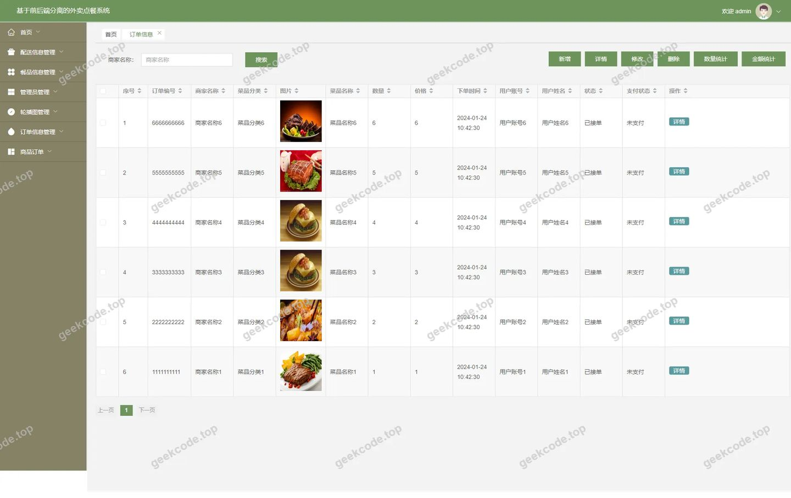
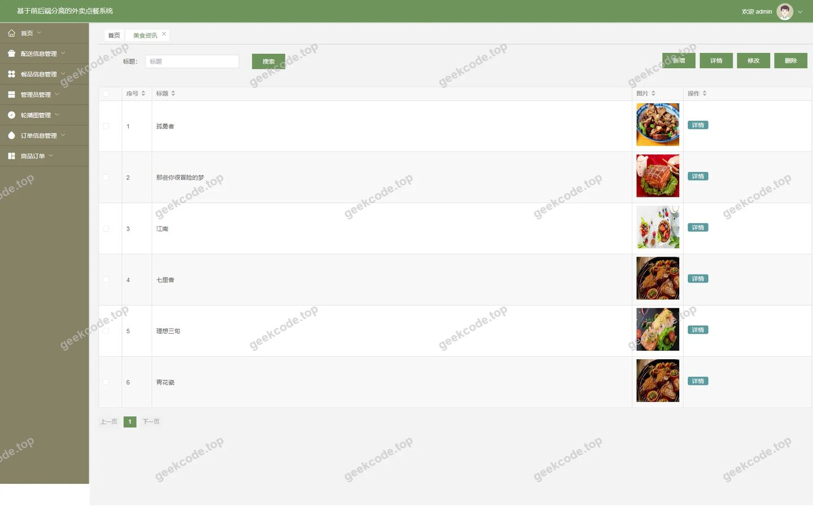
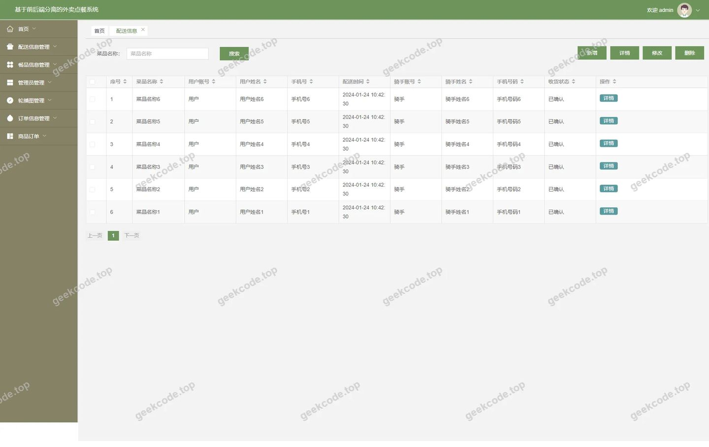
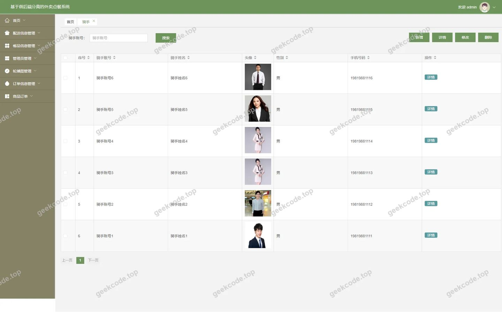
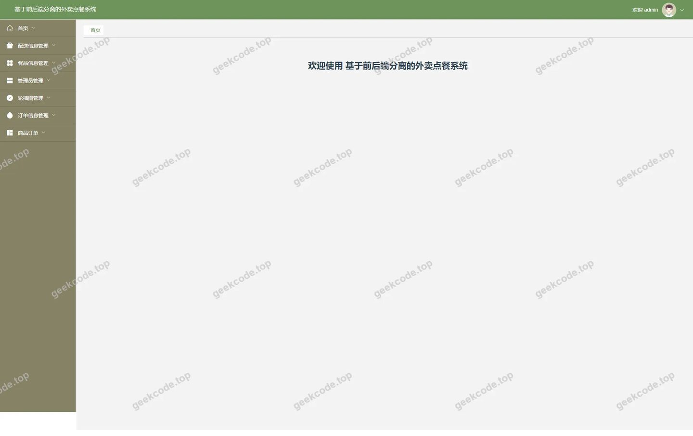
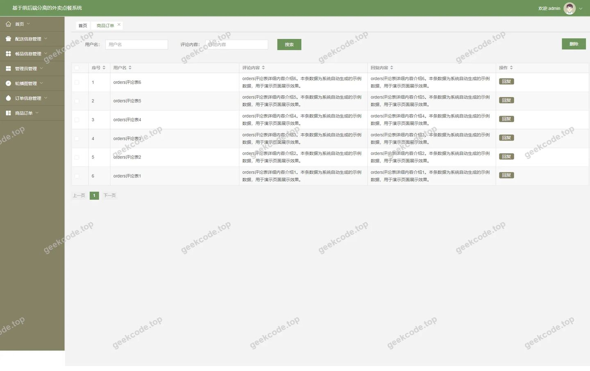

# 基于前后端分离的外卖点餐系统

> 🎓 **计算机毕业设计 · 基于前后端分离的外卖点餐系统**
>
> 本仓库只放**项目介绍 + 运行截图**（截图是站点带水印的原图，存在仓库 `images/` 里）。
>
> 👉 **完整可运行源码 / 数据库脚本 / 部署文档：[点我获取](https://geekcode.top/archives/%E5%9F%BA%E4%BA%8E%E5%89%8D%E5%90%8E%E7%AB%AF%E5%88%86%E7%A6%BB%E7%9A%84%E5%A4%96%E5%8D%96%E7%82%B9%E9%A4%90%E7%B3%BB%E7%BB%9F?utm_source=github)**
>
> 💬 咨询微信：**ir9372**　|　🌐 更多项目：[极客代码 geekcode.top](https://geekcode.top/?utm_source=github)
>
> 📌 项目详情页：<https://geekcode.top/archives/%E5%9F%BA%E4%BA%8E%E5%89%8D%E5%90%8E%E7%AB%AF%E5%88%86%E7%A6%BB%E7%9A%84%E5%A4%96%E5%8D%96%E7%82%B9%E9%A4%90%E7%B3%BB%E7%BB%9F?utm_source=github>

<table><td width="230" align="center"> <b>扫码加微信 ir9372</b></td><td valign="middle">📦 源码 = 项目介绍 + 全部运行截图 + 数据库 + 部署文档 👉 点上方任意截图，直接跳到 <b>极客代码 geekcode.top</b> 详情页</td></table>

---

<h1>基于前后端分离的外卖点餐系统</h1>
<h2>项目概述</h2>

本项目旨在构建一个基于前后端分离架构的外卖点餐系统，解决传统餐饮行业在订单管理、配送调度及用户交互方面的效率低下问题。系统核心功能涵盖菜品展示、在线下单、骑手配送管理及后台综合运营监控。适用人群包括普通消费者、入驻商家、外卖骑手以及平台管理员。技术架构上，后端采用 Spring Boot 框架结合 MyBatis-Plus 实现高效的数据持久化与业务逻辑处理，使用 Apache Shiro 进行安全权限控制；前端基于 Vue.js 生态构建响应式界面，通过 RESTful API 与后端交互。该系统实现了从点餐到配送的全流程数字化闭环，提升了用户体验与管理效率。

<h2>技术架构</h2>
<h3>总体架构</h3>

系统采用经典的前后端分离模式：

<ul>
<li><strong>表现层（Frontend）</strong>：基于 Vue.js 框架构建单页面应用（SPA），负责用户界面渲染、路由跳转及数据展示。通过 Axios 发送 HTTP 请求与后端通信。</li>
<li><strong>业务逻辑层（Backend）</strong>：基于 Spring Boot 快速搭建微服务或单体应用结构，利用其自动配置特性简化开发流程。控制器（Controller）接收请求，服务层（Service）处理核心业务逻辑。</li>
<li><strong>数据访问层（DAO）</strong>：采用 MyBatis-Plus 作为 ORM 框架，提供通用的 CRUD 操作接口，减少样板代码，同时支持复杂 SQL 查询以优化性能。</li>
<li><strong>安全层</strong>：集成 Apache Shiro，实现身份认证（Authentication）和授权（Authorization），确保不同角色只能访问其权限范围内的资源。</li>
</ul>
<h3>核心技术选型理由</h3>
<ol>
<li><strong>Spring Boot</strong>: 提供开箱即用的嵌入式服务器（Tomcat/Jetty等）和自动配置机制，极大降低了部署复杂度，适合快速迭代开发。</li>
<li><strong>MyBatis-Plus</strong>: 相比原生 MyBatis，提供了更强大的通用 Mapper 和条件构造器，显著提高了数据库操作效率，且对 MySQL 有良好支持。</li>
<li><strong>Apache Shiro</strong>: 轻量级且灵活的安全框架，易于与 Spring Boot 整合，能够细粒度地控制菜单和按钮级别的访问权限，保障系统数据安全。</li>
<li><strong>MySQL</strong>: 成熟的关系型数据库，具备高可用性和事务支持，适合存储订单、用户信息等结构化数据。</li>
</ol>
<h2>功能模块</h2>

根据提供的路由配置及截图信息，系统主要划分为以下功能模块：

<h3>后台管理端功能</h3>

后台管理系统面向管理员、商家及骑手，通过不同的路由入口实现差异化功能：

<ol>
<li><strong>系统管理与配置 (<code>/config</code>)</strong></li>
</ol>
<ul>
<li>负责系统基础参数的设置与维护，如轮播图配置、站点名称修改等全局性设置。</li>
</ul>
<ol start="2">
<li><strong>用户与权限管理 (<code>/users</code>, <code>/yonghu</code>)</strong></li>
</ol>
<ul>
<li>管理平台所有注册用户（包括普通用户、商家、骑手）的账号信息，支持增删改查及状态启用/禁用。</li>
</ul>
<ol start="3">
<li><strong>商家中心 (<code>/shangjiaCenter</code>, <code>/shangjia</code>, <code>/shangjiaRegister</code>)</strong></li>
</ol>
<ul>
<li><strong>注册与登录</strong>：新商家可通过 <code>/shangjiaRegister</code> 提交资质入驻。</li>
<li><strong>信息管理</strong>：在 <code>/shangjiaCenter</code> 中维护店铺基本信息。</li>
<li><strong>菜品管理 (<code>/caipinxinxi</code>, <code>/caipinfenlei</code>)</strong>：商家可发布、编辑、下架菜品，并管理菜品分类标签。</li>
</ul>
<ol start="4">
<li><strong>骑手中心 (<code>/qishouCenter</code>, <code>/qishou</code>, <code>/qishouRegister</code>)</strong></li>
</ol>
<ul>
<li><strong>注册与登录</strong>：骑手通过 <code>/qishouRegister</code> 完成注册审核。</li>
<li><strong>接单与配送</strong>：在 <code>/qishouCenter</code> 查看待分配订单，更新配送状态。</li>
<li><strong>个人信息</strong>：维护骑手个人资料及联系方式。</li>
</ul>
<ol start="5">
<li><strong>订单与配送管理 (<code>/orders</code>, <code>/dingdanxinxi</code>, <code>/peisongxinxi</code>, <code>/cart</code>)</strong></li>
</ol>
<ul>
<li><strong>订单处理</strong>：管理员或商家可在 <code>/orders</code> 和 <code>/dingdanxinxi</code> 中查看所有订单详情，处理退款、取消等异常订单。</li>
<li><strong>购物车管理 (<code>/cart</code>)</strong>：监控用户购物车数据，分析潜在转化需求。</li>
<li><strong>配送追踪 (<code>/peisongxinxi</code>)</strong>：实时查看订单的配送进度、骑手位置信息及送达时间统计。</li>
</ul>
<ol start="6">
<li><strong>内容与互动管理 (<code>/news</code>, <code>/discussorders</code>, <code>/discusscaipinxinxi</code>)</strong></li>
</ol>
<ul>
<li><strong>资讯发布 (<code>/news</code>)</strong>：管理员发布美食推荐、优惠活动等平台公告。</li>
<li><strong>评论管理</strong>：审核和管理用户对订单 (<code>/discussorders</code>) 及菜品 (<code>/discusscaipinxinxi</code>) 的评价，维护社区氛围。</li>
</ul>
<ol start="7">
<li><strong>地址管理 (<code>/address</code>)</strong></li>
</ol>
<ul>
<li>管理用户的收货地址簿，支持默认地址设置及地址有效性校验。</li>
</ul>
<h3>前台用户端功能</h3>

虽然未提供具体前台路由列表，但根据个人中心菜单缺失及后台路由反推，前台用户主要参与以下业务流程：

<ol>
<li><strong>首页浏览</strong>：展示热门菜品、最新优惠资讯。</li>
<li><strong>菜品检索与筛选</strong>：按分类查找菜品，查看菜品详情及用户评价。</li>
<li><strong>购物车操作</strong>：添加菜品至购物车，调整数量，计算总价。</li>
<li><strong>订单提交</strong>：选择收货地址，确认订单信息并提交支付。</li>
<li><strong>订单追踪</strong>：查看历史订单及当前配送状态。</li>
<li><strong>评价反馈</strong>：对已完成订单及所购菜品进行评分和文字评论。</li>
</ol>
<h2>用户角色与权限</h2>

系统基于 Shiro 框架设计了多角色权限体系，各角色拥有特定的功能访问范围：

<table>
<thead>
<tr>
<th align="left">角色</th>
<th align="left">描述</th>
<th align="left">可访问功能模块 (依据路由)</th>
</tr>
</thead>
<tbody><tr>
<td align="left"><strong>超级管理员 (Admin)</strong></td>
<td align="left">平台最高权限持有者，负责整体运营与安全。</td>
<td align="left">- 全部后台模块- <code>/config</code>: 系统参数配置- <code>/users</code>, <code>/yonghu</code>: 所有用户管理- <code>/shangjia</code>, <code>/qishou</code>: 商家与骑手审核及管理- <code>/news</code>: 资讯发布- <code>/orders</code>, <code>/dingdanxinxi</code>: 全量订单监管- <code>/discussorders</code>, <code>/discusscaipinxinxi</code>: 评论审核- <code>/address</code>: 地址数据查看- <code>/cart</code>: 购物车数据监控</td>
</tr>
<tr>
<td align="left"><strong>商家 (Shangjia)</strong></td>
<td align="left">入驻平台的餐饮店铺经营者。</td>
<td align="left">- <code>/shangjiaCenter</code>: 个人工作台- <code>/shangjiaRegister</code>: 初始注册（若未审核）- <code>/caipinxinxi</code>: 自家菜品的增删改查- <code>/caipinfenlei</code>: 菜品分类管理- <code>/orders</code>, <code>/dingdanxinxi</code>: 仅查看和处理本店铺订单- <code>/discusscaipinxinxi</code>: 回复本店菜品评论</td>
</tr>
<tr>
<td align="left"><strong>骑手 (Qishou)</strong></td>
<td align="left">负责外卖配送的服务人员。</td>
<td align="left">- <code>/qishouCenter</code>: 个人工作台- <code>/qishouRegister</code>: 初始注册（若未审核）- <code>/peisongxinxi</code>: 查看指派给自己的配送任务- <code>/orders</code>: 查看关联的配送订单状态</td>
</tr>
<tr>
<td align="left"><strong>普通用户 (Yonghu)</strong></td>
<td align="left">点餐消费者。</td>
<td align="left">- <strong>前台功能为主</strong>：- 浏览菜品、加入购物车、下单。- 管理个人地址 (<code>/address</code> 相关接口)。- 查看个人订单记录。- 发表订单和菜品评论。- <em>注：根据现有信息，普通用户无法直接访问上述后台路由，需通过前台API间接交互。</em></td>
</tr>
</tbody></table>
<h2>项目特色与创新点</h2>
<ol>
<li><strong>精细化角色隔离</strong>：通过 Shiro 实现管理员、商家、骑手三类核心角色的严格权限隔离。商家仅能管理自身菜品和订单，骑手仅关注配送环节，确保了数据隐私和业务操作的独立性。</li>
<li><strong>全流程闭环管理</strong>：系统覆盖了从“用户浏览-&gt;下单-&gt;商家接单-&gt;骑手配送-&gt;用户评价”的完整生命周期。特别是将“配送信息 (<code>/peisongxinxi</code>)”和“订单讨论 (<code>/discussorders</code>)”纳入独立模块，强化了物流透明度和售后互动能力。</li>
<li><strong>动态内容运营支持</strong>：内置“美食资讯 (<code>/news</code>)”模块，允许平台方主动推送营销内容，区别于纯工具型点餐系统，增强了用户粘性和活跃度。</li>
<li><strong>高效的开发体验</strong>：利用 MyBatis-Plus 的代码生成器和通用 Mapper 特性，大幅减少了重复性的 DAO 层代码编写，使开发团队能更专注于业务逻辑的实现，符合现代敏捷开发理念。</li>
</ol>
<h2>部署环境</h2>

为确保系统的正常运行，建议采用以下软件及硬件环境：

<h3>软件环境</h3>
<ul>
<li><strong>操作系统</strong>: Windows 10/11, Linux (CentOS 7+, Ubuntu 18.04+), macOS</li>
<li><strong>Java 运行环境</strong>: JDK 1.8 或 JDK 11 (推荐 LTS 版本)</li>
<li><strong>数据库</strong>: MySQL 5.7 或 MySQL 8.0</li>
<li><strong>构建工具</strong>: Maven 3.6+</li>
<li><strong>前端运行环境</strong>: Node.js (LTS 版本，用于编译 Vue 项目), npm/yarn/pnpm</li>
<li><strong>Web 服务器</strong>: Nginx (用于反向代理及静态资源托管) 或 Tomcat (若打包为 WAR)</li>
</ul>
<h3>硬件要求</h3>
<ul>
<li><strong>CPU</strong>: 双核及以上处理器</li>
<li><strong>内存</strong>: 至少 4GB RAM (推荐 8GB 以应对并发请求)</li>
<li><strong>硬盘</strong>: 至少 20GB 可用空间 (用于存放数据库文件及日志)</li>
</ul>
<h3>依赖组件说明</h3>
<ul>
<li><strong>Protobuf</strong>: 项目中包含 <code>protobuf-java</code> 依赖，可能用于特定数据传输序列化或第三方服务对接，部署时需确保相关协议兼容。</li>
<li><strong>Commons Lang3</strong>: Apache Commons Lang 库，提供实用的 Java 类扩展，无需额外安装，随 Maven 依赖自动下载。</li>
</ul>
<h2>五、技术特性</h2>
<ul>
<li>前后端集成部署，前端资源打包至后端 static 目录</li>
<li>使用 MyBatis-Plus 简化数据访问层开发</li>
<li>集成 Shiro 权限框架实现角色权限控制</li>
</ul>
<h2>六、功能模块截图</h2>
<h3>后台管理端</h3>
<h4>后台-地址</h4>

<h4>后台-登录页</h4>

<h4>后台-订单信息</h4>

<h4>后台-美食资讯</h4>

<h4>后台-配送信息</h4>

<h4>后台-骑手</h4>

<h4>页面-首页</h4>

<h4>后台-商品订单</h4>

---

## 获取完整源码

| 项目 | 说明 |
| --- | --- |
| 项目名 | 基于前后端分离的外卖点餐系统 |
| 运行截图 | 本文 8 张（站点带水印原图，仓库 `images/` 目录） |
| 完整源码 | [https://geekcode.top/archives/%E5%9F%BA%E4%BA%8E%E5%89%8D%E5%90%8E%E7%AB%AF%E5%88%86%E7%A6%BB%E7%9A%84%E5%A4%96%E5%8D%96%E7%82%B9%E9%A4%90%E7%B3%BB%E7%BB%9F?utm_source=github](https://geekcode.top/archives/%E5%9F%BA%E4%BA%8E%E5%89%8D%E5%90%8E%E7%AB%AF%E5%88%86%E7%A6%BB%E7%9A%84%E5%A4%96%E5%8D%96%E7%82%B9%E9%A4%90%E7%B3%BB%E7%BB%9F?utm_source=github) |
| 咨询微信 | **ir9372**（备注：jingpin-yuanma） |
| 更多项目 | [极客代码 geekcode.top](https://geekcode.top/?utm_source=github) |

> 需要源码、部署、改配置、跑不起来等问题，加微信 ir9372 沟通，说明项目名即可。
